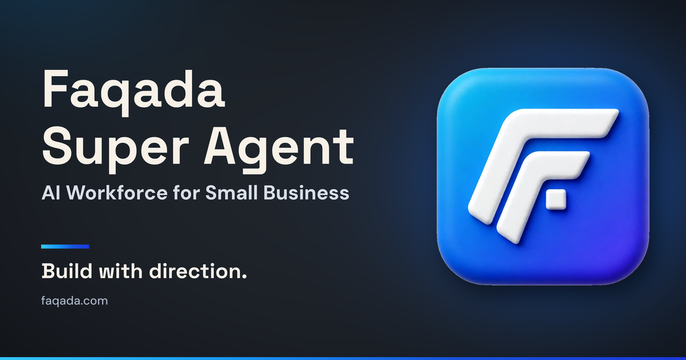
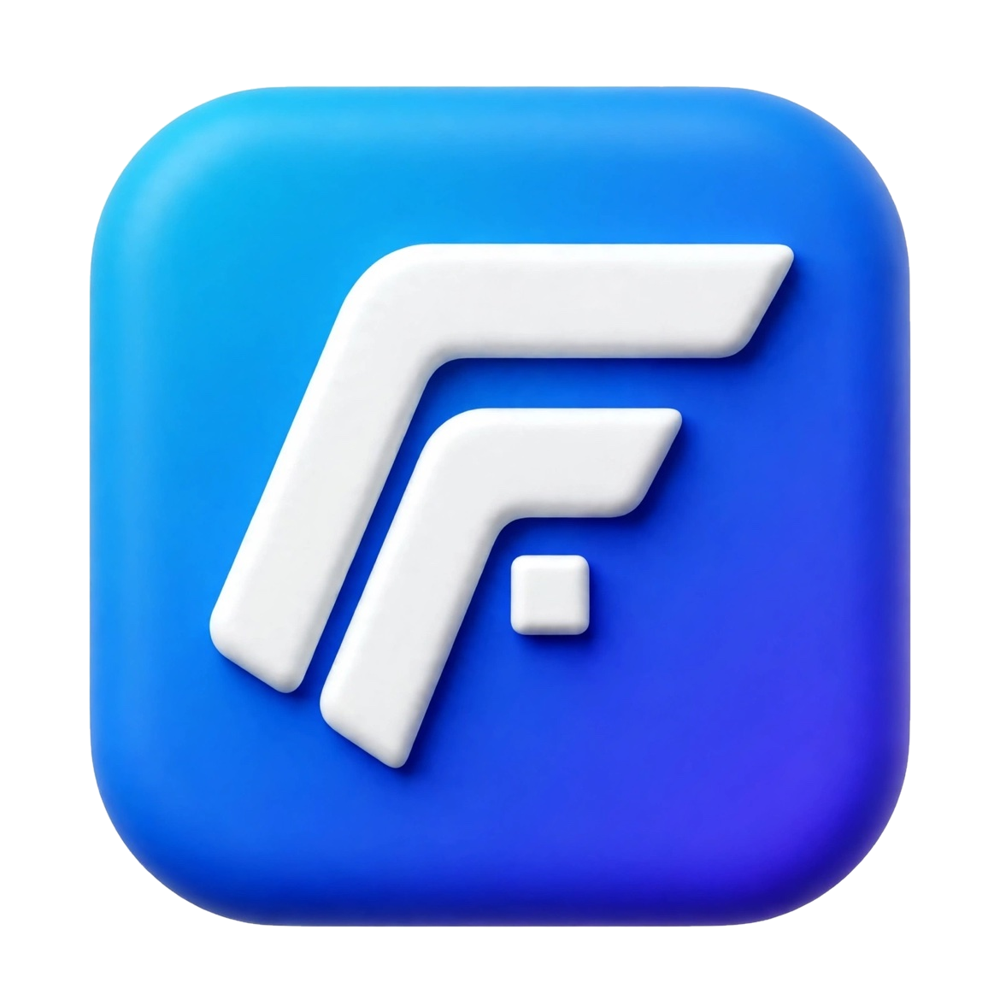

# Faqada

**Build with direction.**

### The Faqada Super Agent — an AI workforce for businesses.

[Website](https://faqada.com) · [What we're building](#what-were-building) · [How work starts](#how-work-starts)

---

## Who we are

Faqada started in 2012. In 2026 we refounded, relaunched, and rebuilt the company — incorporated April 1, 2026 as **Faqada Marketing LLC** — around one product: the **Faqada Super Agent**.

The Super Agent is an AI workforce that runs real functions inside a business: sales, marketing, operations, customer success, recruiting, and intelligence. It is not a chatbot, and it is not a single-purpose tool. It is a team of AI operators working on one core, under the owner's direction.

Faqada runs on its own Super Agent first. Partner businesses run theirs the same way.

The platform is built for businesses as a whole — home services, field and door-to-door sales organizations, direct sales teams, and recruiting and staffing firms among them.

---

## What we're building

Every Super Agent runs on one core:

**Genome → Brain → Foundry → Nightly Loop → Command**

- **Genome** — the business itself, captured once and kept current: identity, offers, voice, rules, and standards.
- **Brain** — the reasoning layer that turns the Genome into decisions and next actions.
- **Foundry** — where new operators, skills, and workflows are built and tested before they go to work.
- **Nightly Loop** — the improvement cycle that reviews the day's work and upgrades the system.
- **Command** — the owner's seat: priorities, approvals, and direction.

On that core works a team of **13 AI operators**, each with a defined job and a defined place in the chain of command.

### Six branches — all operational

| Branch | What it runs |
|---|---|
| **Sales** | Pipeline, follow-up, and sales execution |
| **Marketing & Content** | Content, campaigns, and demand generation |
| **Operations** | The systems that keep the business moving day to day |
| **Customer Success** | Onboarding, support, and retention |
| **Recruiting & Teams** | Hiring, team building, and training |
| **Intelligence & Compliance** | Research, monitoring, and guardrails |

---

## How work starts

Every engagement starts with a **free Genome Scan** — a structured diagnosis of the business. Pricing is set after that diagnosis and scoped to the business itself. There are no fixed packages and no public price list.

For businesses that want the work done for them, Faqada's agency services — web, SEO and AEO, ads, social, video, AI chat and voice — run through the Super Agent, with the platform as the engine underneath.

---

## Partner builds

The Super Agent is built out for partner businesses and communities, including **Mercy**, **Canopy Investment Group**, and **Hearns Hub** — and **Trade Voltage**, an AI trading platform built by equal partners Mark Rosario, Gerald Hearns, and Jerry Vaughan.

---

## Principles

**Human-directed**
AI increases judgment and execution quality. Consequential actions stay visible to the owner, and approval gates stay where they belong.

**Next-best-action first**
Information is useful. Knowing the most valuable thing to do next is better.

**Context over generic prompting**
Useful intelligence understands the business, the customer, the workflow state, and the objective — not just the last message.

**Private by design**
Proprietary product logic, business data, provider credentials, and sensitive infrastructure stay private.

**Provider-agnostic**
The system uses the right model or service for the job instead of depending permanently on one provider.

**Auditable systems**
Important automation, economic events, and state transitions are traceable and testable.

**Measured by outcomes**
Features are evaluated by whether they improve execution — not by whether they demo well.

---

## Public vs. private

Faqada's GitHub presence is intentionally split:

**Public**
- product vision and architecture principles;
- selected technical ideas and experiments that are safe to share;
- open-source acknowledgements and developer-facing material;
- future public tools or reference implementations where appropriate.

**Private**
- production application source;
- proprietary product logic and prompts;
- customer and business data;
- provider credentials and infrastructure secrets;
- internal security, billing, and deployment implementation.

---

### Build with direction.

**Faqada** · [faqada.com](https://faqada.com)

