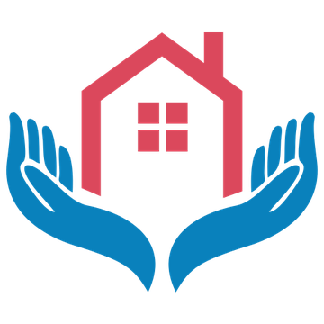
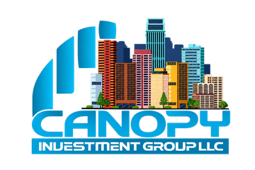

# Faqada

**Build with direction.**

### The Faqada Super Agent — an AI workforce for businesses.

[Website](https://faqada.com) · [What we're building](#what-were-building) · [How work starts](#how-work-starts)

---

## Who we are

Faqada started in 2012. In 2026 we refounded, relaunched, and rebuilt the company — incorporated April 1, 2026 as **Faqada Marketing LLC** — around one product: the **Faqada Super Agent**.

The Super Agent is an AI workforce that runs real functions inside a business: sales, marketing, operations, customer success, recruiting, and intelligence. It is not a chatbot, and it is not a single-purpose tool. It is a team of AI operators working on one core, under the owner's direction.

Faqada runs on its own Super Agent first. Partner businesses run theirs the same way.

The platform is built for businesses as a whole — home services, field and door-to-door sales organizations, direct sales teams, and recruiting and staffing firms among them.

---

## What we're building

Every Super Agent runs on one core:

**Genome → Brain → Foundry → Nightly Loop → Command**

- **Genome** — the business itself, captured once and kept current: identity, offers, voice, rules, and standards.
- **Brain** — the reasoning layer that turns the Genome into decisions and next actions.
- **Foundry** — where new operators, skills, and workflows are built and tested before they go to work.
- **Nightly Loop** — the improvement cycle that reviews the day's work and upgrades the system.
- **Command** — the owner's seat: priorities, approvals, and direction.

On that core works a team of **13 AI operators**, each with a defined job and a defined place in the chain of command.

### Six branches — all operational

| Branch | What it runs |
|---|---|
| **Sales** | Pipeline, follow-up, and sales execution |
| **Marketing & Content** | Content, campaigns, and demand generation |
| **Operations** | The systems that keep the business moving day to day |
| **Customer Success** | Onboarding, support, and retention |
| **Recruiting & Teams** | Hiring, team building, and training |
| **Intelligence & Compliance** | Research, monitoring, and guardrails |

---

## How work starts

Every engagement starts with a **free Genome Scan** — a structured diagnosis of the business. Pricing is set after that diagnosis and scoped to the business itself. There are no fixed packages and no public price list.

For businesses that want the work done for them, Faqada's agency services — web, SEO and AEO, ads, social, video, AI chat and voice — run through the Super Agent, with the platform as the engine underneath.

---

## What Faqada is building

Faqada is the build team behind every project below. Each one is a real business or platform with its own identity — Faqada designs, builds, and maintains the systems underneath it.

###  The Faqada Super Agent

The Faqada Super Agent is an AI workforce platform for businesses as a whole. One core — the Business Genome, the Brain, the Foundry, the Nightly Loop, and Command — runs a team of AI operators across six branches: Sales, Marketing & Content, Operations, Customer Success, Recruiting & Teams, and Intelligence & Compliance, all operational. Faqada started in 2012; in 2026 the company was refounded, relaunched, and rebuilt — incorporated April 1, 2026 as Faqada Marketing LLC — around this platform. Every engagement starts with a free Genome Scan, and pricing is set per business after diagnosis. Live: https://faqada.com

###  Prestige Solutions Home Care

Prestige Solutions Home Care is a home care agency in Philadelphia, Pennsylvania, founded by Subrina. The agency provides in-home care across the Philadelphia area and recruits and onboards caregivers. Faqada designed and built Prestige's website — service pages, a working coverage checker, the caregiver careers flow, and the free assessment intake — and serves as the agency's marketing branch. Live: https://prestige-solutions-homecare.vercel.app

###  Trade Voltage

Trade Voltage is an AI trading platform built by three equal partners: Mark Rosario, Gerald Hearns, and Jerry Vaughan. It scans markets and presents trade signals with entries, stops, and targets through a web dashboard connected to TradeLocker. Faqada designed and built the platform — the dashboard, the API, and the scanner engine. Live: https://www.tradevoltage.com

###  Canopy Investment Group

Canopy Investment Group is an education and community platform for investors, founded by Jerry Vaughan. Members learn investing inside a private community, with structured education and live guidance. Faqada is building the Canopy Super Agent for the platform — a dedicated AI operator build for Canopy's members and team. Live: https://canopyinvestmentgroups.com

###  Hearns Hub

Hearns Hub is Gerald Hearns's community platform for athletes, members, businesses, artists, and traders. Faqada audited the platform in depth in October 2026 and is building the Hearns Hub Super Agent — an AI operator team for the community. Live: https://hearnshub.com

###  AI CLOCK — Eri-Tech Global

AI CLOCK is the product of Eri-Tech Global Ltd, founded by Destiny Shaba in Nigeria. Eri-Tech builds AI systems for businesses, and AI CLOCK is its flagship time-and-automation product. Faqada is Eri-Tech's build partner: Faqada built the Eri-Tech Super Agent in October 2026 and works alongside the Eri-Tech team as the product grows.

###  Kimesha Walters

Kimesha Walters is an author, speaker, and media personality. Her books include *The Comeback Blueprint* and the publicity playbooks she uses with her own clients. Faqada rebuilt her personal brand website — her story, her books, her speaking, and her media work in one place — and it went live on her own domain on November 2, 2026. Live: https://kimeshawalters.com

###  Mpire Marketing Group

Mpire Marketing Group is a door-to-door sales organization. Faqada is Mpire's build partner: Faqada designed and built Sales Pulse, the field-sales operating system Mpire's teams run on — a mobile field app for reps, an operations console for managers, and a performance portal for clients — and supports Mpire's wider sales tooling.

###  BridgeLine

BridgeLine is a communications relay for incarcerated people and their families. A person inside adds one email contact in CorrLinks/TRULINCS, and BridgeLine turns that email channel into something that feels like texting — messages, family groups, scheduled messages, reminders, news, sports, and weather — with a dedicated phone number for each person. Faqada designed and built BridgeLine; the first person it serves is the founder's brother.

**The full picture:** 26 repositories are under active development across these businesses and the internal work behind them. Client source code stays private by design — this page is the public map: the names, the marks, and what each project is. Nothing here exposes code, data, or private client details.

## Partner builds

The Super Agent is built out for partner businesses and communities, including **Mercy**, **Canopy Investment Group**, and **Hearns Hub** — and **Trade Voltage**, an AI trading platform built by equal partners Mark Rosario, Gerald Hearns, and Jerry Vaughan.

---

## Principles

**Human-directed**
AI increases judgment and execution quality. Consequential actions stay visible to the owner, and approval gates stay where they belong.

**Next-best-action first**
Information is useful. Knowing the most valuable thing to do next is better.

**Context over generic prompting**
Useful intelligence understands the business, the customer, the workflow state, and the objective — not just the last message.

**Private by design**
Proprietary product logic, business data, provider credentials, and sensitive infrastructure stay private.

**Provider-agnostic**
The system uses the right model or service for the job instead of depending permanently on one provider.

**Auditable systems**
Important automation, economic events, and state transitions are traceable and testable.

**Measured by outcomes**
Features are evaluated by whether they improve execution — not by whether they demo well.

---

## Public vs. private

Faqada's GitHub presence is intentionally split:

**Public**
- product vision and architecture principles;
- selected technical ideas and experiments that are safe to share;
- open-source acknowledgements and developer-facing material;
- future public tools or reference implementations where appropriate.

**Private**
- production application source;
- proprietary product logic and prompts;
- customer and business data;
- provider credentials and infrastructure secrets;
- internal security, billing, and deployment implementation.

---

### Build with direction.

**Faqada** · [faqada.com](https://faqada.com)

